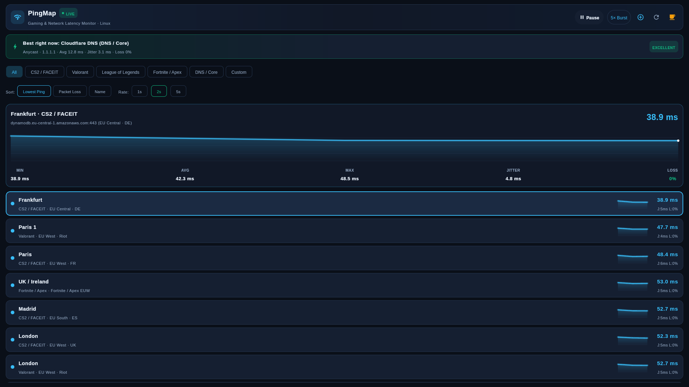

# PingMap

**Cross-platform live gaming server ping, jitter, and packet loss monitor for Linux, Windows 11, and Android.**

Built with **Kotlin + Compose Multiplatform** — zero root/admin privileges required, real-time TCP RTT latency graphs, best-server recommendations, and custom IP/host monitoring.

## Features

- **Multi-Game & Network Presets:**
  - **CS2 / FACEIT:** Frankfurt, Amsterdam, Vienna/Zurich, Stockholm, London, Paris, Madrid, US East
  - **Valorant:** Frankfurt, Paris, London, Stockholm, Milan, Tokyo
  - **League of Legends:** EUW, EUNE, NA, KR
  - **Fortnite / Apex Legends:** EU, UK, NA East, NA West, Asia (Singapore)
  - **DNS & Core Backbone:** Cloudflare (`1.1.1.1`), Google (`8.8.8.8`), Quad9 (`9.9.9.9`), OpenDNS (`208.67.222.222`)
  - **Custom Targets:** Add any custom IP, router, VPS, or private game server (`host:port`), persisted locally.
- **Live Telemetry:** Real-time RTT (`ms`), Min / Avg / Max, **Jitter**, **Packet Loss (%)**, quality grade badge (`EXCELLENT` / `GOOD` / `FAIR` / `POOR`), live sparklines, and detailed latency canvas chart.
- **5× Burst Test & Adjustable Rate:** Switch between `1s`, `2s`, `5s` live polling or run an instant 5-ping burst test.
- **100% Free & Open Source (MIT):** No ads, no accounts, no telemetry.

## Downloads

Grab the latest release for your platform from [GitHub Releases](https://github.com/ilievi187/pingmap/releases):

- **Linux:** `PingMap-1.0.0-x86_64.AppImage`, `.deb`, `.rpm`, or portable `.tar.gz`
- **Windows 11:** `PingMap-1.0.0-windows-x64.msi` or portable `.zip`
- **Android:** `pingmap-1.0.0-android.apk`

## Support

If PingMap helps you dodge laggy matches, you can support development at [buymeacoffee.com/aurorauap](https://buymeacoffee.com/aurorauap).
